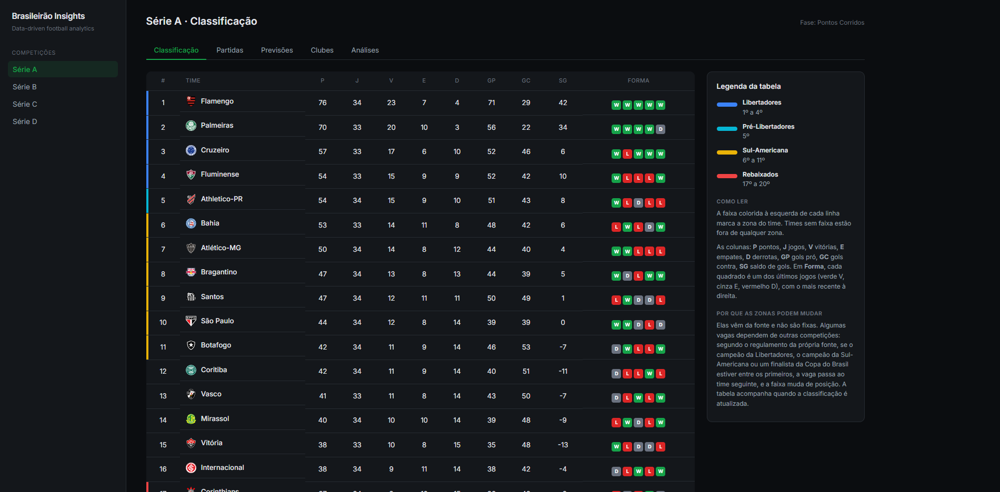
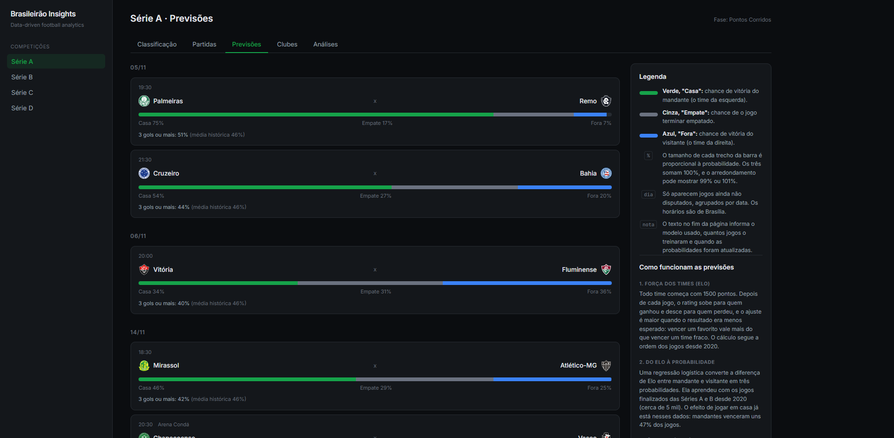
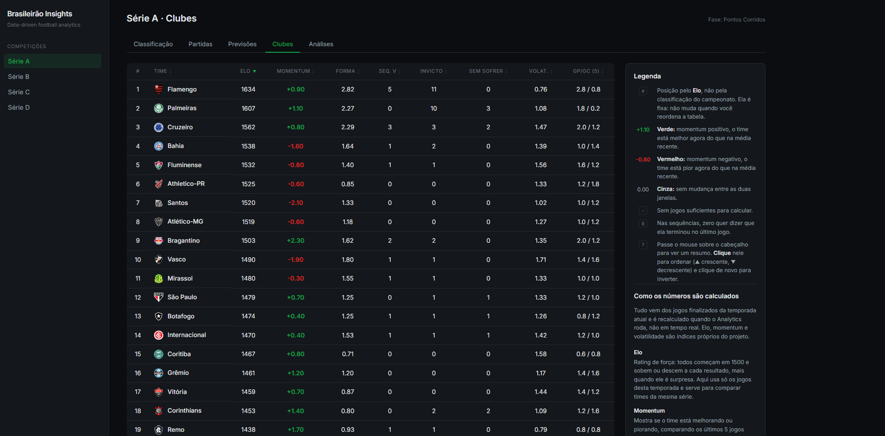
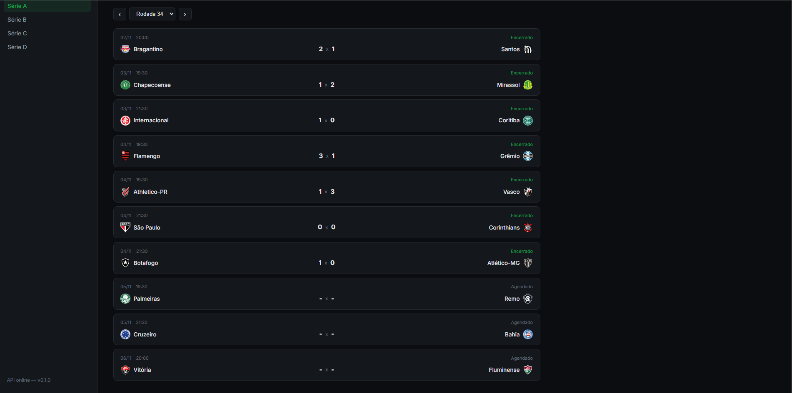
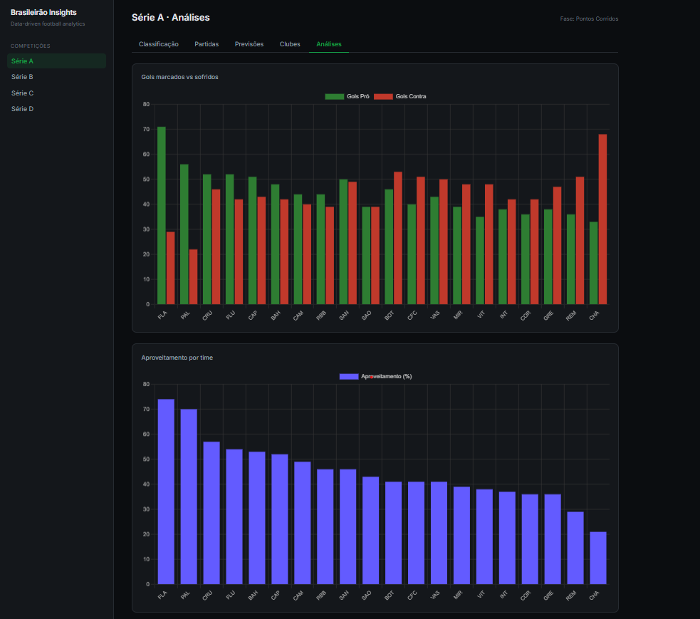
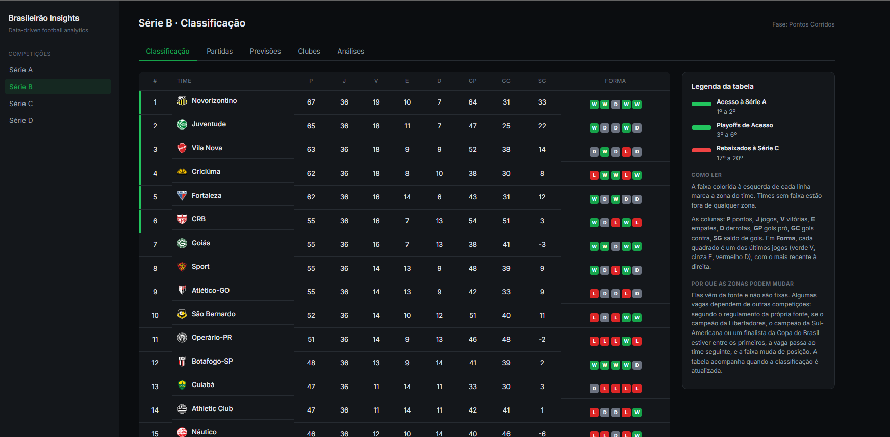
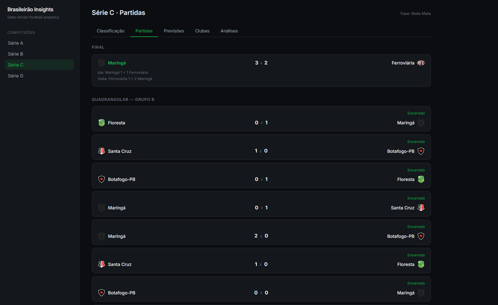

<a id="top"></a>

# Data-Driven Brasileirão Insights

[](https://github.com/amquaresma/data-driven-brasileirao-insights/actions/workflows/tests.yml)

> 🇧🇷 **Português e inglês neste README.** Este documento tem duas versões completas. A versão em português vem primeiro; basta rolar a página para baixo para ler em inglês ([ir direto](#english)).
>
> 🇺🇸 **English and Portuguese in this README.** This document has two complete versions. The Portuguese one comes first; just scroll down to read it in English ([jump to it](#english)).

---

<a id="pt"></a>

## 🇧🇷 Português

Plataforma full stack de análise do futebol brasileiro (Séries A, B, C e D). Reúne duas fontes de dados com identificadores diferentes, normaliza tudo num banco PostgreSQL, calcula métricas próprias (Elo, momentum, forma, sequências, volatilidade) e treina modelos de previsão avaliados sem vazamento de dados. O front mostra classificação por fase e grupo, partidas, previsões e métricas por clube.

Projeto de portfólio, feito para demonstrar engenharia de dados, modelagem relacional, estatística, Machine Learning e desenvolvimento full stack.

<!-- TODO: trocar "em breve" pelos links depois do deploy -->
- **Demo ao vivo:** _em breve_
- **API (Swagger em `/docs`):** _em breve_
- **Repositório:** https://github.com/amquaresma/data-driven-brasileirao-insights

### Telas

| | |
|---|---|
|  |  |
| Classificação com zonas de Libertadores, Sul-Americana e rebaixamento (vêm da fonte) | Previsões de casa/empate/fora e de 3 gols ou mais, com legenda lateral |
|  |  |
| Métricas por clube, com ordenação por coluna | Partidas por rodada |
|  |  |
| Gráficos de análise da classificação | Classificação da Série B |
|  |  |
| Série C: fases, quadrangulares e final | Série D: confrontos de mata-mata com ida, volta e agregado |

### Destaques

- **Reconciliação de identidade entre fontes.** Os mesmos times, ligas e jogos têm IDs e grafias diferentes em cada API (`team_external_ids`, `competition_external_ids`, `match_external_ids`). Casos ambíguos foram revisados por uma pessoa, nunca adivinhados.
- **Fases e grupos.** Séries C e D mudam de formato ao longo do ano (pontos corridos, grupos, mata-mata). O modelo de dados trata isso com `phases`, `groups` e `rounds`.
- **Features sem vazamento.** `match_features` guarda, para cada jogo, apenas o que era conhecido antes dele.
- **Avaliação rigorosa.** Janelas crescentes no tempo, bootstrap pareado e intervalos de confiança de 95%, em vez de um único teste.
- **Resultados negativos documentados.** Se uma feature não ajudou, está escrito aqui.
- **Nada de dado inventado.** O que a fonte não entrega fica `NULL`.
- **Atualização diária automática** (GitHub Actions), respeitando o limite do plano gratuito da API.

### Arquitetura

```
 campeonato-brasileiro-api (CLI/Node)        Highlightly Football API (REST)
                  │                                      │
                  └───────────────┬──────────────────────┘
                                  ▼
          Ingestão (Python): buscar → normalizar → reconciliar IDs
                                  ▼
              PostgreSQL (Supabase) com RLS de leitura pública
                 ┌────────────────┼─────────────────┐
                 ▼                ▼                 ▼
             Analytics       match_features     ML (avaliação e previsões)
                 └────────────────┼─────────────────┘
                                  ▼
                       FastAPI (somente leitura)
                                  ▼
                    React + Vite + Chart.js
```

**Stack:** Python 3.12, FastAPI, Pandas, NumPy, scikit-learn, SciPy, HTTPX, Pydantic · PostgreSQL (Supabase) · React 19, Vite, Chart.js · GitHub Actions.

A chave `service_role` do Supabase fica só no backend e nos secrets do GitHub, nunca no front.

### Dados e cobertura

| Série | Fonte | Cobertura |
|---|---|---|
| A e B | Highlightly (jogos) + campeonato-brasileiro-api (classificação) | Jogos de 2020 a 2026; classificação de 2026 |
| C | Highlightly (1ª fase) + carga manual (quadrangulares e final) | 2026. Os 26 jogos manuais foram conferidos contra a Highlightly: 26 de 26 placares idênticos |
| D | Carga manual | 2026: 96 times em 16 grupos e 128 jogos de mata-mata. A Highlightly não cobre a Série D, então **não há conferência independente** |

Estatísticas por time (xG, posse, finalizações), eventos e box score por jogador estão sendo coletados para a Série A de 2026, limitados pela cota gratuita (100 requisições por dia). O histórico de 2020 a 2025 só tem resultados.

### Modelo de dados (resumo)

`competitions`, `phases`, `groups`, `rounds`, `matches`, `teams`, `standings_entries` · tabelas de IDs externos · `match_statistics` (formato chave-valor, porque a fonte envia nomes abertos), `match_events`, `players`, `player_match_statistics` (com xG, xA e xGOT) · `team_rolling_stats`, `team_form_scores`, `team_streaks`, `team_volatility`, `team_elo_ratings`, `team_momentum` · `match_features` · `match_predictions`.

As migrações estão em `database/migrations/` (0001 a 0014). Todas as tabelas têm RLS ligado, com política de leitura pública.

### Analytics (índices próprios)

São heurísticas documentadas, não padrões oficiais:

- **Médias móveis** de 3, 5 e 10 jogos (gols, pontos).
- **Forma ponderada:** média de pontos dos últimos 10 jogos com peso decrescente (o mais recente pesa mais), escala de 0 a 3.
- **Sequências:** vitórias, invencibilidade, jogos sem sofrer gol, marcando.
- **Volatilidade:** média do desvio padrão dos pontos e do saldo de gols nos últimos 10 jogos.
- **Elo:** início em 1500, K = 20, sem ajuste de mando de campo.
- **Momentum:** `2 × Δ pontos + Δ gols marcados + Δ gols sofridos`, comparando os últimos 5 jogos com os últimos 10.

### Machine Learning

**Método.** Features pré-jogo (`match_features`) e avaliação em 6 janelas crescentes (treina no passado, prevê o bloco seguinte), com 2.984 jogos previstos das Séries A e B. Métrica: log loss (menor é melhor). A diferença entre modelos tem intervalo de 95% por bootstrap pareado.

| Comparação | Diferença de log loss | IC 95% |
|---|---|---|
| Resultado: Elo vs. frequência histórica | −0,028 | [−0,036; −0,019] |
| Resultado: modelo completo vs. só Elo | +0,001 | [−0,001; +0,004] (sem diferença) |
| Mais de 2,5 gols: Poisson (Elo) vs. frequência | −0,003 | [−0,005; −0,001] |
| Resultado: Poisson vs. Elo logístico | +0,006 | [+0,002; +0,010] (Poisson é pior) |

**Leitura honesta.**

- O sinal vem do Elo. Forma recente, médias de gols e dias de descanso não acrescentaram nada mensurável.
- O ganho sobre a frequência histórica é real, mas modesto (cerca de 3% no log loss do resultado e 0,5% em mais de 2,5 gols). Foram várias comparações, então o ganho em gols deve ser lido com cautela.
- Modelos em produção: `elo-logit-v1` (regressão logística sobre a diferença de Elo) para casa/empate/fora, e Poisson sobre a diferença de Elo para "3 gols ou mais".
- Na tela, as previsões são apresentadas como **probabilidades, não palpites**.
- A **calibração real** das previsões ainda não foi medida: ela depende de jogos já disputados que tenham previsão salva.

### Automação

O workflow `.github/workflows/atualizar-dados.yml` roda todo dia às 06:00 UTC (03:00 em Brasília) e também sob demanda: classificação, jogos e placares, detalhe da Série A (até 80 chamadas), Analytics, features e previsões. Cada passo roda mesmo se o anterior falhar, e o job fica vermelho para a falha aparecer. As credenciais ficam nos secrets do repositório.

### Limitações

- **Série D** sem cobertura da Highlightly: dados carregados à mão a partir de resultados publicados na imprensa esportiva, sem conferência em fonte primária.
- **Série D, detalhes:** em 4 confrontos da 2ª fase a fonte repetia o mandante da ida na volta, e o mando da volta foi inferido pelo agregado. O confronto Água Santa x Velo Clube (2ª fase) não veio na fonte, os pênaltis do playoff Goiatuba x São José-RS também não, e os gols sofridos do Azuriz foram derivados (GP − SG).
- **Série C, quadrangulares:** dois desempates foram ordenados por gols pró, e o critério oficial não veio na fonte.
- **Fonte de classificação** (campeonato-brasileiro-api) só expõe a rodada ativa; o histórico vem da Highlightly.
- **Elo** sem regressão à média entre temporadas, e as Séries A e B têm Elo separado (quem sobe ou desce de divisão perde o rating). O Elo da aba Clubes usa só 2026; o das previsões usa o histórico desde 2020.
- **Previsões** não consideram lesões, escalações nem odds.
- **Horários** exibidos no fuso de Brasília; jogos manuais das Séries C e D não têm horário.
- **Fora do escopo:** login e favoritos.
- **Montar tudo do zero não é um comando único:** a primeira carga exige reconciliar nomes de times na mão (ver `services/data-pipeline`).

### Testes

`python -m pytest -q` roda testes dos cálculos (Elo, médias móveis, forma, sequências, volatilidade, momentum), das features sem vazamento (mudar o placar de um jogo nunca altera as features dele) e dos normalizadores. Também travam a consistência dos dados carregados à mão (somas de pontos, gols, vitórias e derrotas, e os classificados de cada fase do mata-mata). Não usam banco, API nem a cota da Highlightly, e rodam a cada push no GitHub Actions.

### Como rodar localmente

Requisitos: Python 3.12, Node 22 ou superior e um projeto no Supabase.

```bash
# 1. Banco: rode, em ordem, os arquivos de database/migrations/ no SQL Editor do Supabase

# 2. Variáveis de ambiente: copie os .env.example de cada serviço para .env
#    SUPABASE_URL, SUPABASE_SERVICE_ROLE_KEY e, no data-pipeline, HIGHLIGHTLY_API_KEY
#    (services/api, services/data-pipeline, services/analytics, services/ml)

# 3. Python
python3 -m venv services/api/.venv && source services/api/.venv/bin/activate
pip install -r services/requirements-pipeline.txt   # tudo (pipeline, Analytics, ML)
# a API sozinha só precisa de services/api/requirements.txt

# 4. Node (CLI da campeonato-brasileiro-api)
npm ci --prefix services/data-pipeline

# 5. API
cd services/api && uvicorn app.main:app --port 8000

# 6. Front (em outro terminal); apps/web/.env.local com VITE_API_URL=/api
cd apps/web && npm install && npm run dev
```

Scripts úteis: `ingest.py` e `ingest_highlightly.py` (`services/data-pipeline`), `compute_rolling_stats.py` e `compute_match_features.py` (`services/analytics`), `evaluate_rolling.py`, `evaluate_poisson.py` e `predict_upcoming.py` (`services/ml`).

### Estrutura do repositório

```
apps/web                 front-end (React)
services/api             API (FastAPI)
services/data-pipeline   ingestão: fontes, normalizadores, repositórios, dados manuais
services/analytics       índices próprios e match_features
services/ml              avaliação e previsões
database/migrations      SQL versionado
.github/workflows        atualização diária
```

### Fontes e aviso

- [campeonato-brasileiro-api](https://github.com/ezefranca/campeonato-brasileiro-api) (leitura do ge.globo.com)
- [Highlightly Football API](https://highlightly.net)

Projeto educacional, sem vínculo com CBF, ge ou Highlightly. As previsões não são recomendação de aposta.

**Autor:** Matheus Quaresma ([@amquaresma](https://github.com/amquaresma))

[↑ Voltar ao topo](#top)

---

<a id="english"></a>

## 🇺🇸 English

A full stack analytics platform for Brazilian football (Series A, B, C and D). It brings together two data sources with different identifiers, normalizes everything into a PostgreSQL database, computes its own metrics (Elo, momentum, form, streaks, volatility) and trains prediction models evaluated without data leakage. The front end shows standings by phase and group, matches, predictions and per-club metrics.

A portfolio project built to demonstrate data engineering, relational modeling, statistics, Machine Learning and full stack development.

<!-- TODO: replace "soon" with the links after deploying -->
- **Live demo:** _soon_
- **API (Swagger at `/docs`):** _soon_
- **Repository:** https://github.com/amquaresma/data-driven-brasileirao-insights

### Screenshots

| | |
|---|---|
|  |  |
| Standings with Libertadores, Sul-Americana and relegation zones (provided by the source) | Home/draw/away and 3-or-more-goals predictions, with a side legend |
|  |  |
| Per-club metrics, sortable by column | Matches by round |
|  |  |
| Standings analysis charts | Series B standings |
|  |  |
| Series C: phases, quadrangulars and final | Series D: knockout ties with first leg, second leg and aggregate |

### Highlights

- **Identity reconciliation across sources.** The same teams, leagues and matches have different IDs and spellings in each API (`team_external_ids`, `competition_external_ids`, `match_external_ids`). Ambiguous cases were reviewed by a person, never guessed.
- **Phases and groups.** Series C and D change format during the year (round-robin, groups, knockout). The data model handles it with `phases`, `groups` and `rounds`.
- **Leakage-free features.** `match_features` stores, for each match, only what was known before it was played.
- **Rigorous evaluation.** Rolling-origin windows, paired bootstrap and 95% confidence intervals, instead of a single test.
- **Negative results documented.** If a feature did not help, it is written down here.
- **No invented data.** Whatever the source does not provide stays `NULL`.
- **Automatic daily refresh** (GitHub Actions), within the API's free-tier limit.

### Architecture

```
 campeonato-brasileiro-api (CLI/Node)        Highlightly Football API (REST)
                  │                                      │
                  └───────────────┬──────────────────────┘
                                  ▼
          Ingestion (Python): fetch → normalize → reconcile IDs
                                  ▼
              PostgreSQL (Supabase) with public-read RLS
                 ┌────────────────┼─────────────────┐
                 ▼                ▼                 ▼
             Analytics       match_features     ML (evaluation and predictions)
                 └────────────────┼─────────────────┘
                                  ▼
                        FastAPI (read-only)
                                  ▼
                    React + Vite + Chart.js
```

**Stack:** Python 3.12, FastAPI, Pandas, NumPy, scikit-learn, SciPy, HTTPX, Pydantic · PostgreSQL (Supabase) · React 19, Vite, Chart.js · GitHub Actions.

The Supabase `service_role` key lives only in the backend and in GitHub secrets, never in the front end.

### Data and coverage

| Series | Source | Coverage |
|---|---|---|
| A and B | Highlightly (matches) + campeonato-brasileiro-api (standings) | Matches from 2020 to 2026; 2026 standings |
| C | Highlightly (first phase) + manual load (quadrangulars and final) | 2026. The 26 manual matches were cross-checked against Highlightly: 26 of 26 scores identical |
| D | Manual load | 2026: 96 teams in 16 groups and 128 knockout matches. Highlightly does not cover Series D, so there is **no independent cross-check** |

Team statistics (xG, possession, shots), events and per-player box scores are being collected for Series A 2026, limited by the free-tier quota (100 requests per day). The 2020–2025 history contains results only.

### Data model (summary)

`competitions`, `phases`, `groups`, `rounds`, `matches`, `teams`, `standings_entries` · external ID tables · `match_statistics` (key-value format, because the source sends open-ended names), `match_events`, `players`, `player_match_statistics` (with xG, xA and xGOT) · `team_rolling_stats`, `team_form_scores`, `team_streaks`, `team_volatility`, `team_elo_ratings`, `team_momentum` · `match_features` · `match_predictions`.

Migrations are in `database/migrations/` (0001 to 0014). Every table has RLS enabled with a public-read policy.

### Analytics (custom indices)

These are documented heuristics, not official standards:

- **Rolling averages** over 3, 5 and 10 matches (goals, points).
- **Weighted form:** average points over the last 10 matches with decreasing weights (the latest weighs most), on a 0 to 3 scale.
- **Streaks:** wins, unbeaten, clean sheets, scoring.
- **Volatility:** mean of the standard deviation of points and of goal difference over the last 10 matches.
- **Elo:** starts at 1500, K = 20, no home-advantage adjustment.
- **Momentum:** `2 × Δ points + Δ goals scored + Δ goals conceded`, comparing the last 5 matches with the last 10.

### Machine Learning

**Method.** Pre-match features (`match_features`) and evaluation over 6 rolling-origin windows (train on the past, predict the next block), with 2,984 predicted matches from Series A and B. Metric: log loss (lower is better). Differences between models come with a 95% interval from a paired bootstrap.

| Comparison | Log loss difference | 95% CI |
|---|---|---|
| Result: Elo vs. historical frequency | −0.028 | [−0.036, −0.019] |
| Result: full model vs. Elo only | +0.001 | [−0.001, +0.004] (no difference) |
| Over 2.5 goals: Poisson (Elo) vs. frequency | −0.003 | [−0.005, −0.001] |
| Result: Poisson vs. logistic Elo | +0.006 | [+0.002, +0.010] (Poisson is worse) |

**Honest reading.**

- The signal comes from Elo. Recent form, goal averages and rest days added nothing measurable.
- The gain over the historical frequency is real but modest (about 3% of log loss for the result and 0.5% for over 2.5 goals). Several comparisons were made, so the goals gain should be read with caution.
- Models in production: `elo-logit-v1` (logistic regression on the Elo difference) for home/draw/away, and a Poisson model on the Elo difference for "3 or more goals".
- The UI presents predictions as **probabilities, not picks**.
- The **real calibration** of the predictions has not been measured yet: it needs played matches that have a saved prediction.

### Automation

The workflow `.github/workflows/atualizar-dados.yml` runs every day at 06:00 UTC (03:00 in Brasília) and on demand: standings, matches and scores, Series A details (up to 80 calls), Analytics, features and predictions. Each step runs even if the previous one fails, and the job turns red so failures stay visible. Credentials live in repository secrets.

### Limitations

- **Series D** is not covered by Highlightly: data was loaded by hand from results published in the sports press, with no primary-source verification.
- **Series D, details:** in 4 second-round ties the source repeated the first-leg home team in the second leg, and the second-leg venue was inferred from the aggregate. The Água Santa vs. Velo Clube tie (second round) was missing from the source, as were the penalties of the Goiatuba vs. São José-RS playoff, and Azuriz's goals conceded were derived (GF − GD).
- **Series C, quadrangulars:** two tiebreaks were ordered by goals scored, and the official criterion was not in the source.
- **The standings source** (campeonato-brasileiro-api) only exposes the active round; history comes from Highlightly.
- **Elo** has no mean reversion between seasons, and Series A and B have separate Elo (a team changing division loses its rating). The Elo in the Clubs tab uses 2026 only; the one behind the predictions uses history since 2020.
- **Predictions** do not consider injuries, line-ups or odds.
- **Times** are shown in Brasília time; manually loaded Series C and D matches have no kick-off time.
- **Out of scope:** login and favourites.
- **Building everything from scratch is not a single command:** the first load requires reconciling team names by hand (see `services/data-pipeline`).

### Tests

`python -m pytest -q` runs tests for the calculations (Elo, rolling averages, form, streaks, volatility, momentum), for the leakage-free features (changing a match's own score never changes its features) and for the normalizers. They also lock the consistency of the hand-loaded data (points, goals, wins and losses totals, and who advances in each knockout phase). They use no database, API or Highlightly quota, and run on every push in GitHub Actions.

### Running locally

Requirements: Python 3.12, Node 22 or newer and a Supabase project.

```bash
# 1. Database: run the files in database/migrations/ in order, in the Supabase SQL Editor

# 2. Environment: copy each service's .env.example to .env
#    SUPABASE_URL, SUPABASE_SERVICE_ROLE_KEY and, in data-pipeline, HIGHLIGHTLY_API_KEY
#    (services/api, services/data-pipeline, services/analytics, services/ml)

# 3. Python
python3 -m venv services/api/.venv && source services/api/.venv/bin/activate
pip install -r services/requirements-pipeline.txt   # everything (pipeline, Analytics, ML)
# the API alone only needs services/api/requirements.txt

# 4. Node (campeonato-brasileiro-api CLI)
npm ci --prefix services/data-pipeline

# 5. API
cd services/api && uvicorn app.main:app --port 8000

# 6. Front end (another terminal); apps/web/.env.local with VITE_API_URL=/api
cd apps/web && npm install && npm run dev
```

Useful scripts: `ingest.py` and `ingest_highlightly.py` (`services/data-pipeline`), `compute_rolling_stats.py` and `compute_match_features.py` (`services/analytics`), `evaluate_rolling.py`, `evaluate_poisson.py` and `predict_upcoming.py` (`services/ml`).

### Repository layout

```
apps/web                 front end (React)
services/api             API (FastAPI)
services/data-pipeline   ingestion: sources, normalizers, repositories, manual data
services/analytics       custom indices and match_features
services/ml              evaluation and predictions
database/migrations      versioned SQL
.github/workflows        daily refresh
```

### Sources and disclaimer

- [campeonato-brasileiro-api](https://github.com/ezefranca/campeonato-brasileiro-api) (reads ge.globo.com)
- [Highlightly Football API](https://highlightly.net)

Educational project, not affiliated with CBF, ge or Highlightly. Predictions are not betting advice.

**Author:** Matheus Quaresma ([@amquaresma](https://github.com/amquaresma))

[↑ Back to top](#top)
